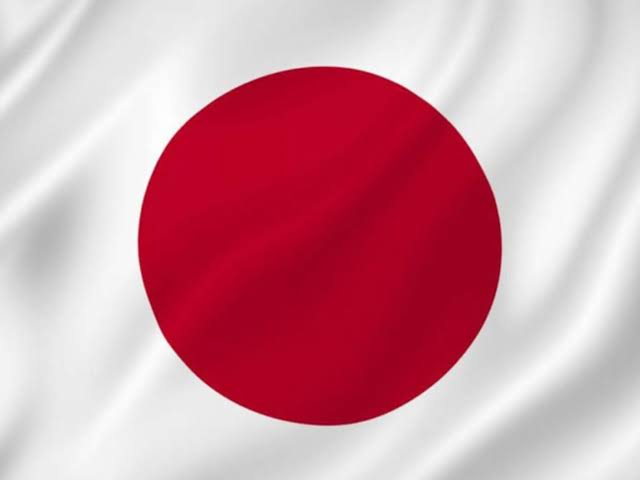
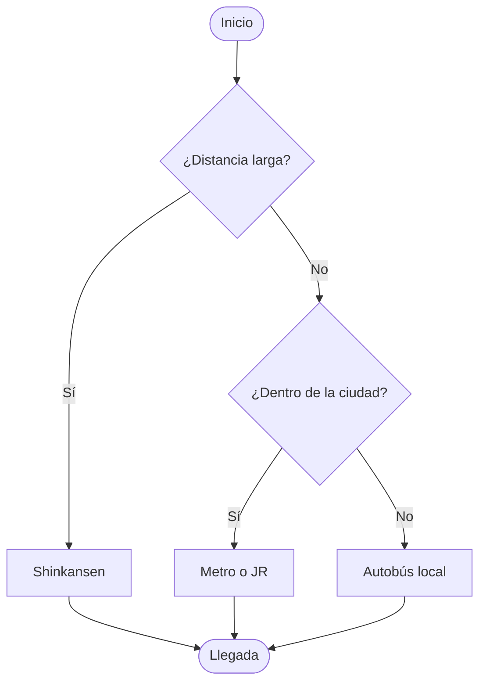
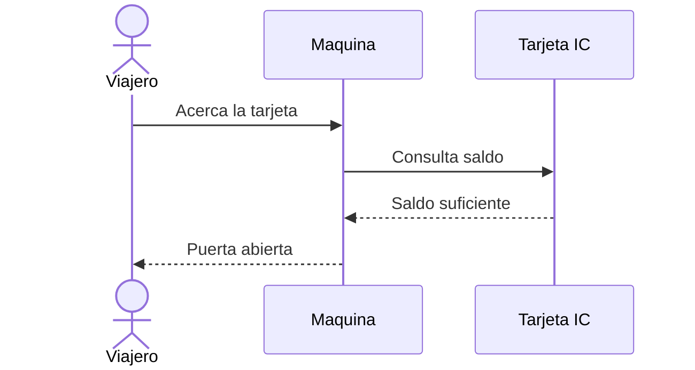
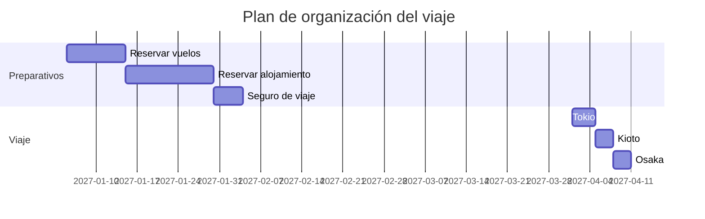
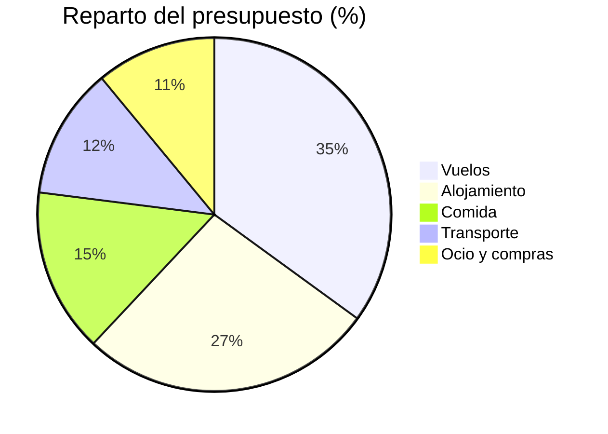

<!-- 
Proyecto Markdown Alexander 
 -->


## Índice

1. [Introducción](#introducción)
2. [Antes de viajar](#antes-de-viajar)
3. [Itinerario](#itinerario)
4. [Lugares de interés](#lugares-de-interés)
5. [Gastronomía](#gastronomía)
6. [Transporte](#transporte)
7. [Presupuesto](#presupuesto)
8. [Consejos prácticos](#consejos-prácticos)
9. [Matemáticas del viaje](#matemáticas-del-viaje)
10. [Diagramas del viaje](#diagramas-del-viaje)
11. [Conclusión](#conclusión)

---

# Introducción

[⬆️Volver al índice](#índice)

## ¿Por qué Japón?

Japón es un país donde conviven **templos milenarios** y *rascacielos futuristas*. En un mismo día puedes pasear por un santuario sintoísta y, horas después, perderte entre luces de neón.

Esta guía recoge lo que **más me ha interesado** al planificar el viaje.\
*Está pensada para un viaje de 10 días (primera vez en el país).*\
***Cada sección se puede leer por separado.***

### Un poco de contexto

| Dato | Valor |
|------|-------|
| Capital | Tokio |
| Moneda | Yen (JPY, ¥) |
| Idioma | Japonés |
| Huso horario | UTC+9 |

> [!NOTE]
> Los datos de precios y condiciones de esta guía son orientativos.



---

# Antes de viajar

[⬆️Volver al índice](#índice)

## Documentación

- Pasaporte en vigor
  - Para estancias turísticas cortas, los ciudadanos españoles no necesitan visad (consultar siempre la web oficial)
  - Conviene tener una copia digital
- Seguro de viaje
- Reservas
  1. Vuelos
  2. Alojamientos
  3. Trenes de larga distancia

## Lista de tareas

- [x] Elegir destino
- [x] Decidir las fechas aproximadas
- [ ] Reservar vuelos
- [ ] Reservar alojamiento en Tokio
- [ ] Reservar alojamiento en Kioto
- [ ] Contratar seguro de viaje
- [ ] Preparar la tarjeta de pago sin comisiones

## Enlaces útiles

- [Web oficial de turismo de Japón (JNTO)](https://www.japan.travel/es/)
- [Visit Japan Web](https://www.digital.go.jp/en/services/visit-japan-web)

> [!WARNING]
> Verifica los requisitos de entrada y los trámites online **antes** del viaje, porque pueden cambiar.

> [!TIP]
> Descarga mapas sin conexión y una app de traducción antes de salir de casa.

---


# Itinerario

[⬆️Volver al índice](#índice)

## Resumen por ciudades

| Ciudad | Días | Noches | Enfoque |
|:-------|:----:|-------:|:--------|
| Tokio | 4 | 4 | Moderna y ecléctica |
| Kioto | 3 | 3 | Templos y tradición |
| Osaka | 3 | 3 | Comida y ocio |

## Detalle

### Tokio (días 1–4)

1. Llegada y paseo por **Shinjuku**
2. Asakusa y templo Senso-ji
3. Shibuya y Harajuku
4. Excursión a Hakone o al monte Fuji

### Kioto (días 5–7)

1. Barrio de Gion
2. Santuario Fushimi Inari
3. Bosque de bambú de Arashiyama

### Osaka (días 8–10)

1. Excursión a Nara
2. Dotonbori y Castillo de Osaka
3. Compras y regreso


---


# Lugares de interés

[⬆️Volver al índice](#índice)

## Imprescindibles

- **Fushimi Inari** (Kioto): miles de torii rojos
- **Castillo de Osaka**: símbolo de la ciudad
- **Tokyo Skytree**: vistas panorámicas
- **Parque de Nara**: ciervos en libertad
- **Monte Fuji**: icono del país

## Estacionalidad

- **Primavera** (finales de marzo – abril): cerezos en flor (*sakura*)
- **Verano**: calor y humedad, festivales
- **Otoño** (noviembre): hojas rojas (*koyo*)
- **Invierno**: menos turistas, nieve en el norte

<details>
<summary><b>Ver más ideas</b></summary>

<br>

- Museo Ghibli (Mitaka)
- Mercado de Tsukiji
- Templo Kinkaku-ji (Pabellón Dorado)
- Isla de Miyajima

</details>


---


# Gastronomía

[⬆️Volver al índice](#índice)

## Platos que probar

| Plato | Descripción | Ciudad típica |
|:------|:-----------:|--------------:|
| Ramen | Fideos en caldo | Tokio |
| Sushi | Arroz y pescado | Tokio |
| Okonomiyaki | Tortita salada | Osaka |
| Takoyaki | Bolas de pulpo | Osaka |
| Kaiseki | Menú tradicional | Kioto |

## Etiqueta básica

1. Decir *itadakimasu* antes de comer
2. No clavar los palillos en el arroz
3. Sorber los fideos está bien visto
4. No es habitual dejar propina

> [!IMPORTANT]
> Si tienes alergias alimentarias, lleva una tarjeta traducida al japonés explicándolas.

---


# Transporte

[⬆️Volver al índice](#índice)

## Opciones

- **Shinkansen**: tren de alta velocidad entre ciudades
- **Metro y JR**: dentro de las ciudades
- **Tarjetas IC** (Suica, PASMO, ICOCA): pago de transporte y pequeñas compras
- Autobuses locales

## Comprobar el saldo de una tarjeta IC (ejemplo ficticio)

La función en `bash`

```bash
SALDO=2000
TARIFA=210
echo $((SALDO / TARIFA)) trayectos
```

## Calculadora de trayectos en Python

La función en `python`

```python
def trayectos_restantes(saldo: int, tarifa: int) -> int:
    """Devuelve cuántos trayectos permite el saldo."""
    return saldo // tarifa

print(trayectos_restantes(2000, 210))
```

---

# Presupuesto

[⬆️Volver al índice](#índice)

## Estimación orientativa (10 días)

| Concepto | Importe (€) |
|:---------|------------:|
| Vuelos | 900 |
| Alojamiento | 700 |
| Comida | 400 |
| Transporte | 300 |
| Ocio y compras | 300 |
| **Total** | **2600** |


> [!NOTE]
> Estas cifras son **supuestos de ejemplo** para practicar el formato, no precios reales.

---


# Consejos prácticos

[⬆️Volver al índice](#índice)

## Antes de salir

- Los enchufes son de tipo A: lleva adaptador
- ~~Reserva una SIM o eSIM con datos~~
- Lleva algo de efectivo: aún hay sitios que no aceptan tarjeta

## Ya en destino

- Hay pocas papeleras: lleva una bolsa para tu basura
- Habla bajo en el transporte público
- Descálzate donde se indique

### Teléfonos de emergencia

| Servicio | Número |
|:---------|:------:|
| Policía | 110 |
| Bomberos y ambulancia | 119 |


---


# Matemáticas del viaje

[⬆️Volver al índice](#índice)

## Divisas

El importe en euros se obtiene dividiendo los yenes entre el tipo de cambio $T$ (yenes por euro):

$$M_{EUR} = \frac{M_{JPY}}{T}$$

## Presupuesto

El gasto total es la suma de las partidas, y el gasto medio diario es $\bar{g} = \frac{P_{total}}{D}$, donde $D$ es el número de días:

$$P_{total} = \sum_{i=1}^{n} g_i$$

## Velocidad del Shinkansen

Con $d \approx 513\ \text{km}$ entre Tokio y Kioto y un tiempo de $t \approx 2{,}25\ \text{h}$:

$$v = \frac{d}{t} = \frac{513}{2{,}25} \approx 228\ \text{km/h}$$

## Diferencia horaria

Con España en invierno (UTC+1) y Japón (UTC+9), la diferencia es:

$$\Delta t = (+9) - (+1) = 8\ \text{horas}$$

## Combinatoria

Si tuviera que elegir 3 ciudades entre 5 candidatas:

$$\binom{5}{3} = \frac{5!}{3!\,(5-3)!} = 10$$

---


# Diagramas del viaje

[⬆️Volver al índice](#índice)

## Diagrama de flujo: ¿cómo me muevo?



## Diagrama de secuencia: pagar con tarjeta IC



## Diagrama de Gantt: planificación



## Diagrama circular: reparto del presupuesto




# Conclusión

[⬆️Volver al índice](#índice)

Japón ofrece una mezcla única de **cultura**, **gastronomía** y **tecnología**.\
Con una buena planificación, 10 días permiten conocer lo esencial de **Tokio**, **Kioto** y **Osaka**.
